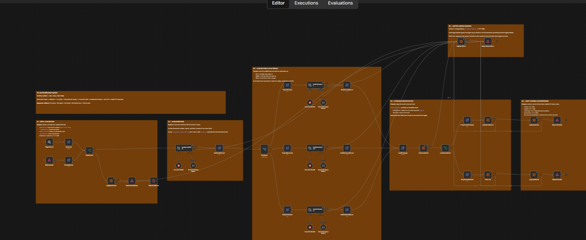
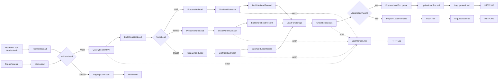

# AI Lead Qualification System

> An end-to-end B2B lead qualification and outreach automation built with **n8n**, **Groq**, structured LLM outputs, authenticated webhooks, Data Tables, deduplication, audit logging, and centralized error handling.



## Overview

This project automates the first stages of a B2B sales pipeline.

A lead is received through an authenticated webhook, normalized and validated, evaluated by an AI model, assigned a score and a qualification level, routed to the appropriate follow-up strategy, enriched with a personalized outreach draft, and then stored or updated in n8n Data Tables.

The workflow also records business events in a dedicated audit table and returns clear HTTP responses for successful creation, updates, invalid requests, authentication failures, and internal errors.

### Main capabilities

- Authenticated `POST` webhook endpoint
- Input normalization and validation
- AI lead scoring from `0` to `100`
- `hot`, `warm`, and `cold` qualification
- Structured LLM output validation
- Route-specific AI outreach generation
- Lead deduplication by email
- Create-or-update persistence logic
- Stable `lead_id` preservation during updates
- Audit/event logging
- Centralized internal-error handling
- Explicit API status codes: `201`, `200`, `400`, `403`, and `500`
- Manual trigger path for development and testing

---

## Architecture



---

## Lead scoring

The qualification model returns a structured object containing:

- `lead_score`
- `qualification`
- `priority`
- `reasoning`
- `recommended_action`

The scoring prompt uses five business dimensions:

| Dimension | Weight |
|---|---:|
| Budget and purchasing capacity | 30 |
| Urgency / timeline | 20 |
| Decision-making authority | 20 |
| Company fit and size | 15 |
| Clarity and relevance of the need | 15 |

Qualification thresholds:

| Score | Qualification | Priority |
|---:|---|---|
| `75–100` | `hot` | `high` |
| `45–74` | `warm` | `medium` |
| `0–44` | `cold` | `low` |

The workflow uses a structured output parser so downstream nodes receive predictable fields instead of free-form model text.

---

## Route-specific follow-up

### Hot leads

Hot leads are marked as sales-ready and receive an immediate-sales-follow-up strategy.

Typical workflow metadata:

```text
pipeline_stage = sales_ready
action_type = immediate_sales_followup
follow_up_within_hours = 24
assigned_team = sales
```

The AI drafts a personalized email focused on the stated business need and suggests a short discovery call.

### Warm leads

Warm leads are moved into nurturing with a softer follow-up.

Typical target:

```text
follow_up_within_hours = 72
assigned_team = sales
```

The generated message is intentionally less urgent than the hot-lead version.

### Cold leads

Cold leads enter a longer nurture path.

Typical target:

```text
pipeline_stage = nurturing
action_type = cold_lead_nurture
follow_up_within_hours = 168
assigned_team = marketing
```

The prompt explicitly avoids aggressive sales language and avoids inventing case studies, resources, results, or company facts.

---

## Tech stack

| Component | Role |
|---|---|
| **n8n** | Workflow orchestration |
| **Docker** | Local/self-hosted runtime |
| **PostgreSQL** | n8n persistence in the self-hosted environment |
| **Groq** | LLM inference |
| **GPT-OSS 120B via Groq** | Lead qualification and outreach generation |
| **n8n Structured Output Parser** | Enforces predictable AI output |
| **n8n Data Tables** | Lead storage and audit-event storage |
| **Webhook Header Auth** | API access protection |
| **Cloudflare Tunnel** | Optional external testing/development exposure |

---

## API

### Endpoint

```http
POST /webhook/portfolio/lead
```

The webhook uses header authentication.

Use your own secret value. Never commit it to Git.

```http
Content-Type: application/json
X-Webhook-Secret: YOUR_WEBHOOK_SECRET
```

### Request body

Example:

```json
{
  "full_name": "Alex Martin",
  "email": "alex.martin@example.com",
  "company": "NexaCloud",
  "job_title": "Head of IT",
  "industry": "Technology",
  "company_size": 80,
  "country": "France",
  "budget": 22000,
  "need": "Automate lead qualification, sales follow-up and customer support using AI",
  "timeline": "Within 2 weeks",
  "source": "website"
}
```

### Normalization

The workflow:

- trims text fields;
- converts email addresses to lowercase;
- converts `company_size` and `budget` to numbers;
- creates a `lead_id` when one is not provided;
- defaults `source` to `website`.

Required validation currently checks that key lead fields such as the identifier, name, email, company, and need are present before AI processing continues.

---

## Example request

```bash
curl -i -X POST "http://localhost:5678/webhook/portfolio/lead" \
  -H "Content-Type: application/json" \
  -H "X-Webhook-Secret: YOUR_WEBHOOK_SECRET" \
  -d '{
    "full_name": "Alex Martin",
    "email": "alex.martin@example.com",
    "company": "NexaCloud",
    "job_title": "Head of IT",
    "industry": "Technology",
    "company_size": 80,
    "country": "France",
    "budget": 22000,
    "need": "Automate lead qualification and follow-up with AI",
    "timeline": "Within 2 weeks",
    "source": "website"
  }'
```

---

## API responses

### New lead — `201 Created`

```json
{
  "success": true,
  "status": "created",
  "lead_id": "LEAD-...",
  "email": "alex.martin@example.com",
  "qualification": "hot",
  "lead_score": 84,
  "message": "Lead created successfully"
}
```

### Existing lead — `200 OK`

```json
{
  "success": true,
  "status": "updated",
  "lead_id": "LEAD-...",
  "email": "alex.martin@example.com",
  "qualification": "hot",
  "lead_score": 81,
  "message": "Lead updated successfully"
}
```

The same `lead_id` is preserved when an existing lead is updated.

### Invalid lead — `400 Bad Request`

```json
{
  "success": false,
  "status": "rejected",
  "error": "invalid_lead",
  "message": "Missing or invalid required fields"
}
```

### Invalid authentication — `403 Forbidden`

Authentication is handled by the n8n webhook credential before the business workflow is executed.

### Internal error — `500 Internal Server Error`

```json
{
  "success": false,
  "status": "error",
  "error": "internal_server_error",
  "message": "An unexpected error occurred"
}
```

The public API response deliberately remains generic instead of leaking technical error details.

---

## Persistence and deduplication

The workflow uses two n8n Data Tables.

### `portfolio_leads`

Stores the latest known state for each lead, including:

```text
lead_id
full_name
email
company
job_title
industry
company_size
country
budget
need
timeline
source
lead_score
qualification
priority
reasoning
recommended_action
qualified_at
pipeline_stage
action_type
follow_up_within_hours
assigned_team
next_step
outreach_subject
outreach_email_body
outreach_call_to_action
outreach_status
lead_status
record_updated_at
```

Deduplication is performed using the normalized email address.

If the email already exists:

```text
CheckLeadExists
→ LeadAlreadyExists
→ PrepareLeadForUpdate
→ UpdateLeadRecord
```

If the email does not exist:

```text
CheckLeadExists
→ LeadAlreadyExists
→ PrepareLeadForInsert
→ Insert row
```

A key implementation detail is that updates preserve the original business `lead_id`; the internal Data Table row ID is used only to target the database row.

### `portfolio_lead_events`

Acts as an audit trail.

Representative fields:

```text
event_id
lead_id
email
event_type
qualification
lead_score
status
source
execution_id
occurred_at
error_type
error_message
```

Event types include:

```text
created
updated
rejected
internal_error
```

This separates the current state of a lead from the history of what happened to that lead.

---

## Error handling

The workflow uses explicit error outputs on critical nodes.

AI-processing failures converge on a central internal-error logger. The same strategy is used for critical persistence operations, while logger failures are sent directly to the final error response to avoid recursive logging failures.

Conceptually:

```text
Critical node failure
        ↓
LogInternalError
        ↓
RespondInternalError
        ↓
HTTP 500
```

This design keeps client-facing responses predictable while retaining an internal audit path.

---

## Security

Implemented controls:

- Header-authenticated webhook
- Secret stored in n8n Credentials instead of workflow code
- Generic client-facing `500` response
- No API keys or webhook secrets stored in this repository
- Authentication checked before lead processing
- Separate development/manual trigger from the production webhook path

Recommended production hardening:

- Use a stable HTTPS endpoint
- Keep n8n behind a reverse proxy or authenticated tunnel
- Store all credentials in n8n / environment secrets
- Rotate webhook secrets periodically
- Add rate limiting
- Add request-size limits
- Restrict inbound network access where appropriate
- Configure execution-data retention
- Back up PostgreSQL and workflow exports
- Add monitoring/alerting for repeated failures
- Consider an idempotency key for high-volume integrations

---

## Validation and regression tests

The stable V1 was tested end-to-end with the following cases:

| Test | Expected result | Validated |
|---|---|---|
| Create a new valid lead | `201 Created` | ✅ |
| Send the same email again | `200 OK` + same `lead_id` | ✅ |
| Omit a required field | `400 Bad Request` | ✅ |
| Use an invalid webhook secret | `403 Forbidden` | ✅ |
| Force an LLM failure | `500 Internal Server Error` | ✅ |
| Audit created event | event stored | ✅ |
| Audit updated event | event stored | ✅ |
| Audit rejected event | event stored | ✅ |
| Audit internal error | event stored | ✅ |

Because AI generation is nondeterministic, the exact score can vary slightly between executions even when the classification remains consistent.

---

## Running locally

### Prerequisites

- Docker / Docker Compose
- n8n
- PostgreSQL
- Groq API credential

### 1. Start n8n

If your n8n environment is already configured with Docker Compose:

```bash
docker compose up -d
docker compose ps
```

Open:

```text
http://localhost:5678
```

### 2. Import the workflow

Import:

```text
workflow/ai-lead-qualification-system.json
```

### 3. Configure credentials

In n8n, create or select:

- a **Groq API** credential;
- a **Header Auth** credential for the webhook.

Do not hard-code secrets into Set, Code, or HTTP nodes.

### 4. Create the Data Tables

Create:

```text
portfolio_leads
portfolio_lead_events
```

Re-select those tables in the imported Data Table nodes if the IDs differ from the source environment.

### 5. Activate the workflow

After verifying credentials and Data Tables, publish/activate the workflow.

### 6. Test the endpoint

Use the request example above with your own webhook secret.

---

## Repository structure

```text
ai-lead-qualification-system/
├── README.md
├── assets/
│   └── workflow-overview.png
└── workflow/
    └── ai-lead-qualification-system.json
```

---

## Design decisions

### Why structured AI output?

Free-form LLM responses are difficult to route reliably. Structured output gives downstream nodes explicit fields such as `lead_score`, `qualification`, and `recommended_action`.

### Why store leads and events separately?

`portfolio_leads` represents the current state.

`portfolio_lead_events` represents the history.

This makes it possible to update a lead without losing the event trail.

### Why deduplicate by email?

For this portfolio use case, email is the simplest stable business identifier available at ingestion time.

### Why keep the public 500 response generic?

Clients need a predictable error contract, but should not receive internal stack traces, provider errors, credentials, or implementation details.

---

## Future improvements

Possible V2 extensions:

- CRM integration (HubSpot, Pipedrive, Salesforce)
- Real email delivery after an approval step
- Slack / Microsoft Teams alerts for hot leads
- Human-in-the-loop approval for outreach
- Calendar booking integration
- Lead-source analytics dashboard
- Web UI for reviewing qualified leads
- Retry/backoff strategy for LLM/API failures
- Idempotency keys
- Rate limiting
- Automated test workflow
- Persistent production deployment with a custom domain
- Metrics and observability
- Multi-tenant configuration for client deployments

---

## What this project demonstrates

This project was built to demonstrate practical skills in:

- workflow automation;
- API/webhook design;
- AI integration;
- prompt design;
- structured LLM output;
- data validation;
- branching/business logic;
- persistence and deduplication;
- audit logging;
- error handling;
- authentication;
- Docker-based self-hosting;
- production-oriented workflow design.

---

## Author

**El Hadji Moda Seck**

BUT Réseaux & Télécommunications — Cloud / Systems / Networking / Cybersecurity

LinkedIn: <https://www.linkedin.com/in/el-hadji-moda-seck/>

---

## Project status

**Version 1.0 — Stable portfolio release**

The core workflow has passed create, update, validation, authentication, and forced-error regression tests.
